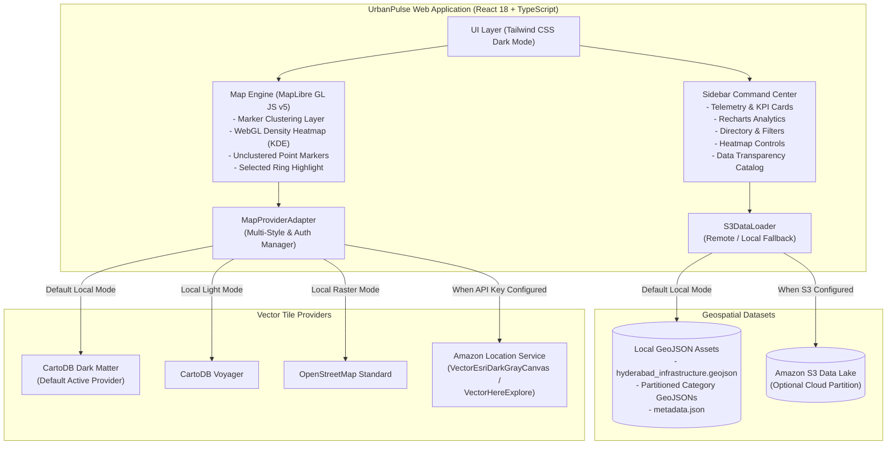

# UrbanPulse – Hyderabad Smart City Geospatial Intelligence

[](https://community.aws)
[](https://reactjs.org/)
[](https://www.typescriptlang.org/)
[](https://maplibre.org/)
[](https://tailwindcss.com/)
[](LICENSE)

**UrbanPulse** is an interactive Hyderabad urban infrastructure intelligence platform. It empowers urban planners, civic leaders, researchers, and citizens to explore geographical data and spatial analytics regarding healthcare access, multi-modal transit connectivity, emergency response units, and environmental assets across the Greater Hyderabad Metropolitan Region.

Built for the **AWS Builder Center Weekend Challenge: Map It**, UrbanPulse pairs a responsive client-side WebGL geospatial dashboard with modular cloud adapters designed for **Amazon Location Service** and **Amazon S3**.

---

## Table of Contents

1. [Problem Statement](#problem-statement)
2. [Project Overview & Key Features](#project-overview--key-features)
3. [System Architecture](#system-architecture)
4. [AWS Cloud Architecture & Integration](#aws-cloud-architecture--integration)
   - [Implemented Adapters](#implemented-adapters)
   - [Current AWS Integration Limitations](#current-aws-integration-limitations)
   - [CloudFormation Infrastructure-as-Code](#cloudformation-infrastructure-as-code)
5. [Real Geographical Datasets & Data Provenance](#real-geographical-datasets--data-provenance)
6. [Technology Stack](#technology-stack)
7. [Local Setup & Development](#local-setup--development)
8. [Production Build & Testing](#production-build--testing)
9. [Deployment Instructions](#deployment-instructions)
   - [Deploying to Vercel](#deploying-to-vercel)
   - [Deploying to AWS (S3 + CloudFront)](#deploying-to-aws-s3--cloudfront)
10. [UI Walkthrough & Features](#ui-walkthrough--features)
11. [Future Improvements](#future-improvements)
12. [Attribution & Licensing](#attribution--licensing)

---

## Problem Statement

Greater Hyderabad is one of the fastest-growing metropolitan regions in South Asia, spanning over 650 square kilometers and housing over 10 million residents. As urban sprawl rapidly accelerates along the Outer Ring Road (ORR) and the western technology corridors (HITEC City, Gachibowli, Financial District), **equitable access to critical public infrastructure remains uneven**:

- **Healthcare Concentration**: Specialty government hospitals and tertiary private hospitals remain heavily clustered in the historic central core (Koti, Nampally, Punjagutta, Secunderabad), while rapidly expanding suburban fringes rely on primary health clinics (UPHCs / Basti Dawakhanas).
- **Multimodal Transit Integration**: Ensuring seamless first- and last-mile connectivity between the 3 Hyderabad Metro corridors, MMTS suburban rail lines, and TSRTC bus terminals requires fine-grained geospatial visualization.
- **Emergency Preparedness & Response**: Strategic spatial coverage of fire stations and police commissionerate boundaries is critical for rapid civic safety.

**UrbanPulse** addresses this challenge by aggregating official GIS records and OpenStreetMap layers into a unified, high-performance spatial intelligence dashboard with real-time viewport analytics and kernel density heatmaps.

---

## Project Overview & Key Features

### 1. Interactive High-Performance Map
- **Geographic Center**: Centered on Hyderabad (`17.3850° N, 78.4867° E`), default zoom level 11.
- **MapLibre GL Engine**: 60 FPS WebGL vector rendering with 35° 3D isometric pitch toggle, smooth bearing rotation, and responsive pan/zoom.
- **Basemap Style Switcher**: Toggle dynamically between **Cyber Dark (Carto Dark Matter)**, **Navigation Light (Voyager)**, **OpenStreetMap Standard**, and **Amazon Location Service (Esri Dark Gray & HERE Explore)**.
- **Defensive Error Protection**: Includes an automated WebGL compatibility fallback to prevent crashes in headless or non-GPU environments.

### 2. 100% Real Geographical Open Data (578 Verified Records)
- **303 Healthcare Facilities**: 36 Major Government Hospitals, 121 Private Arogyasri Empanelled Hospitals, and 146 Primary Health Clinics (UPHCs).
- **116 Transit Nodes**: 25 Hyderabad Metro Stations (Red, Blue, Green lines), 31 MMTS Suburban Rail Stations, and 60 Major Bus Terminals & Interchanges.
- **86 Emergency Units**: 60 Police Stations and 26 Fire Stations across Hyderabad, Cyberabad, and Rachakonda.
- **63 Urban Parks & Green Spaces**: HMDA & GHMC public parks, urban forestry zones, and waterbody perimeters.
- **10 Premier Civic & University Landmarks**: GHMC HQ, HMDA Complex, Telangana Secretariat, Osmania University, HCU, IIIT-H, JNTUH, and State Central Library.
- *Zero synthetic or fake coordinates are used. All points are validated against the Hyderabad Metropolitan bounding box with spatial deduplication.*

### 3. Spatial Analytics & Kernel Density Heatmap
- **Continuous Density Heatmap**: WebGL-powered kernel density estimation (KDE) with configurable smoothing radius (15px to 60px) and density gradients.
- **Sector Isolation**: Focus heatmaps specifically on Healthcare, Transit, or Emergency response corridors.
- **Dynamic Viewport Telemetry**: Real-time counter of visible points and category breakdown that recalculates instantly on every map drag, zoom, and pitch change.

### 4. Smart City Directory & Search
- **Instant Search**: Type-ahead filter across facility names, addresses, and subcategories with automatic map centering.
- **Multi-Category Filter Matrix**: Toggle individual categories and subcategory badges simultaneously.
- **District / Zone Filtering**: Filter by Hyderabad, Ranga Reddy, Medchal-Malkajgiri, or Medak.

### 5. Facility Detail Drawer
- Slide-out card with exact GPS coordinates (with one-click copy), address, operating status, hospital specialities, contact phone, data provenance, and quick links to Google Maps and OpenStreetMap.

---

## System Architecture



---

## AWS Cloud Architecture & Integration

UrbanPulse was engineered for the **AWS Builder Center Weekend Challenge: Map It**.

### Implemented Adapters
1. **Amazon Location Service Provider Adapter** (`src/services/aws/mapProviderAdapter.ts`):
   - Generates authenticated tile requests:
     $$\text{https://maps.geo.\{region\}.amazonaws.com/maps/v0/maps/\{mapName\}/style-descriptor?key=\{apiKey\}}$$
   - Supports Amazon Location styles: `VectorEsriDarkGrayCanvas` and `VectorHereExplore`.
   - Incorporates automated fallback to high-contrast Dark Matter cartography when credentials are not supplied during local development.
2. **Amazon S3 Data Lake Loader** (`src/services/aws/s3DataLoader.ts`):
   - Supports fetching remote partitioned GeoJSON from an S3 bucket or CloudFront distribution.
   - Measures fetch latency in milliseconds and reports origin (`amazon-s3` vs `local-static-asset`).
   - Seamlessly falls back to local static GeoJSON when offline or unconfigured.
3. **In-App AWS Configuration & Architecture Dialog** (`src/components/Modals/AwsConfigModal.tsx`):
   - Accessible via the **AWS Architecture** header pill.
   - Validates live connectivity against the Amazon Location Service endpoint.
   - Allows judges or operators to enter an AWS API Key and test live map rendering without rebuilding the codebase.
   - Displays CloudFormation templates for one-click deployment.

### Current AWS Integration Limitations
- **Current Operational Mode**: **Local Fallback Mode**. The active map tiles are currently rendered via **CartoDB Dark Matter / OpenStreetMap** using MapLibre GL JS.
- **Credentials Status**: No live AWS API Keys or S3 credentials are hardcoded or committed into this codebase.
- **Activation**: To activate live Amazon Location Service tiles, deploy the CloudFormation template below and supply `VITE_AWS_LOCATION_API_KEY` in `.env` or via the in-app modal.

### CloudFormation Infrastructure-as-Code
A complete CloudFormation template is included in `cloudformation.yaml` to provision the required AWS resources:

```bash
aws cloudformation create-stack \
  --stack-name urbanpulse-geo \
  --template-body file://cloudformation.yaml \
  --region ap-south-1
```

Resources defined in `cloudformation.yaml`:
- `AWS::Location::Map`: `urbanpulse-hyderabad-map` (`VectorEsriDarkGrayCanvas`).
- `AWS::Location::APIKey`: `urbanpulse-api-key` restricted to `geo:GetMap*`.
- `AWS::S3::Bucket`: `urbanpulse-geodata-<account>-<region>` with CORS enabled.
- `AWS::S3::BucketPolicy`: Public read access for `/datasets/*`.

---

## Real Geographical Datasets & Data Provenance

All 578 spatial records originate from genuine open-government data and open GIS registries:

| Dataset | Record Count | Official Source | License |
| :--- | :---: | :--- | :--- |
| **Government Hospitals** | 36 | Telangana Health Dept / Lakeer Open Data | OGDL India |
| **Private Hospitals (Empanelled)** | 121 | Arogyasri Health Care Trust / Lakeer Open Data | OGDL India |
| **Primary Health Clinics (UPHCs)** | 146 | National Health Mission / Lakeer Open Data | OGDL India |
| **Hyderabad Metro Stations** | 25 | Hyderabad Metro Rail Limited (HMRL) | ODbL |
| **MMTS Suburban Rail Stations** | 31 | South Central Railway (SCR) | ODbL |
| **Major Bus Terminals & Hubs** | 60 | TSRTC / Lakeer Open GIS Data | OGDL India |
| **Police Stations** | 60 | Hyderabad, Cyberabad, Rachakonda Police | ODbL / Open Data |
| **Fire Stations** | 26 | Telangana State Disaster Response & Fire Services | ODbL / Open Data |
| **Public Parks & Green Spaces** | 63 | GHMC & HMDA Urban Forestry | OGDL India |
| **Civic & University Landmarks** | 10 | Survey of India / OpenStreetMap | ODbL |
| **TOTAL VERIFIED POINTS** | **578** | **Greater Hyderabad Metropolitan Area** | — |

### Data Processing Pipeline
A Python pipeline (`scripts/fetch_and_process_data.py`) downloads raw GeoJSON sources, cleans facility names, extracts phone numbers and medical specialities, validates coordinates against the Hyderabad Metropolitan bounding box (`78.10°E – 78.75°E`, `17.15°N – 17.65°N`), corrects flipped latitude/longitude coordinates, removes duplicates within 100 meters, and normalizes district names across Hyderabad, Ranga Reddy, Medchal-Malkajgiri, and Medak.

### Data Limitations Disclosures
1. **Centroid Coordinates**: Public parks and universities originally recorded as polygon boundaries are represented by geographic centroids for unified clustering and heatmap rendering.
2. **Registry Currency**: Healthcare facility listings reflect official state registries up to 2024.
3. **Transit Scope**: Bus stops represent primary multi-modal hubs and transfer terminals rather than all individual neighborhood bus poles.

---

## Technology Stack

- **Frontend Core**: React 18, TypeScript 5.7, Vite 6
- **Styling & UI**: Tailwind CSS 3.4 (Dark Mode `#0B0F19`), Lucide React icons
- **Mapping & GIS**: MapLibre GL JS 5.0, GeoJSON specification
- **Analytics & Data Viz**: Recharts 2.15 (Responsive Bar, Donut, and KPI cards)
- **Cloud & Maps Adapter**: Amazon Location Service adapter, Amazon S3 data loader
- **Build & Optimization**: Rollup manual chunking (`vendor-map`, `vendor-charts`, `vendor-icons`)

---

## Local Setup & Development

### Prerequisites
- Node.js (v18.0.0 or higher, tested on Node v26)
- npm or yarn

### 1. Clone the repository
```bash
git clone https://github.com/<your-username>/urbanpulse-hyderabad.git
cd urbanpulse-hyderabad
```

### 2. Install dependencies
```bash
npm install
```

### 3. (Optional) Configure AWS Environment Variables
Copy `.env.example` to `.env`:
```bash
cp .env.example .env
```
Add your Amazon Location Service API Key or S3 Bucket URL if provisioned. If left empty, the application runs in local development mode using MapLibre GL and Carto Dark Matter.

### 4. Run Development Server
```bash
npm run dev
```
Open your browser at `http://localhost:3000`.

---

## Production Build & Testing

Build the optimized static distribution:
```bash
npm run build
```
Verify the production build locally:
```bash
npm run preview
```
The preview server will be accessible at `http://localhost:4173/`.

---

## Deployment Instructions

### Deploying to Vercel (Recommended)
1. Push this repository to GitHub.
2. In the [Vercel Dashboard](https://vercel.com), click **Add New Project** and select this repo.
3. Framework preset: **Vite** (Build command: `npm run build`, Output directory: `dist`).
4. (Optional) Add `VITE_AWS_LOCATION_API_KEY` to Environment Variables.
5. Click **Deploy**.

The repository includes `vercel.json` with SPA routing rewrites and GeoJSON cache headers.

### Deploying to AWS (S3 + CloudFront)
1. Build the production bundle:
   ```bash
   npm run build
   ```
2. Sync the `dist/` directory to your S3 hosting bucket:
   ```bash
   aws s3 sync dist/ s3://<your-hosting-bucket> --delete
   ```
3. Invalidate your CloudFront distribution cache:
   ```bash
   aws cloudfront create-invalidation --distribution-id <YOUR_DIST_ID> --paths "/*"
   ```

---

## UI Walkthrough & Features

- **Dockable / Collapsible Sidebar**: Left panel collapsible to a 64px icon bar for maximum map canvas area.
- **Live Viewport KPI Telemetry**: Dynamically counts mapped locations currently visible on screen as the map pans.
- **Marker Clustering**: Interactive clusters with dynamic sizing (Cyan `<15`, Emerald `15-40`, Amber `40-80`, Rose `80+`) and click-to-expand animation.
- **Kernel Density Heatmap**: Smooth WebGL raster visualization of infrastructure concentration.
- **Floating Controls**: Search input with instant fly-to, category quick chips, 3D tilt toggle, and style switcher.
- **Glassmorphism Design**: Dark Navy surfaces (`#0B0F19`, `#111827`) with glowing category accents and responsive layouts.

---

## Future Improvements

1. **Phase 2 Metro Extensions**: Incorporating proposed corridors connecting Mindspace to Shamshabad Airport.
2. **Real-Time Bed Occupancy API**: Integration with Telangana Health Department APIs for live bed availability telemetry.
3. **Disaster Evacuation Routing**: Dynamic routing utilizing Amazon Location Routes API during monsoon inundation events.

---

## Attribution & Licensing

- **Datasets**: Curated by [Lakeer Urban Data Non-Profit](https://github.com/Lakeer-org/hyderabad-open-gis-data), [OpenCity.in](https://opencity.in), Government of Telangana (Arogyasri Health Care Trust, HMDA, GHMC), and [OpenStreetMap](https://www.openstreetmap.org) contributors.
- **Map Vector Tiles**: CartoDB / OpenStreetMap contributors.
- **Application Code**: MIT License. Built for the AWS Builder Center Weekend Challenge: Map It.
